<div align="center">

# GradeLens

### Marking that shows its working.

An AI marking co-pilot for handwritten answers. Every suggested mark points to the student's own words,<br/>
it learns each teacher's standard, and it has to **earn** the right to be approved in bulk, question by question.

[](https://github.com/roybishal362/GradeLens/actions/workflows/ci.yml)


<a href="#measured-results">Measured results</a> ·
<a href="#earned-trust">Earned trust</a> ·
<a href="#product-tour">Product tour</a> ·
<a href="#architecture">Architecture</a> ·
<a href="#getting-started">Getting started</a> ·
<a href="#limitations">Limitations</a>

<br/>

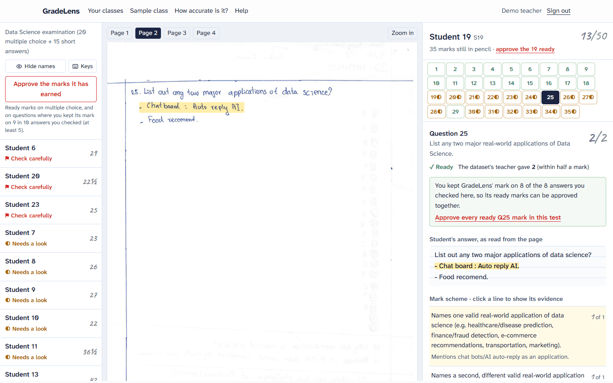

<sub>A real exam script from a public dataset. The words behind the mark are highlighted on the page, the dataset teacher's own mark is shown for comparison, and this question has earned approval together.</sub>

</div>

---

## The problem

AI can take real work off teachers. In a 166-student university course, LLM-assisted marking of handwritten work took **40%** less time than marking in Gradescope ([SIGCSE 2026](https://sigcse2026.sigcse.org/details/sigcse-ts-2026-Papers/118/Fighting-Fire-with-Fire-LLM-Assisted-Grading-of-Handwritten-CS-Assessments)); a study of handwritten maths tests measured about **23%** ([Vanhoyweghen et al., 2026](https://arxiv.org/abs/2603.13083)).

The usual safeguard is "a teacher checks it". That safeguard is weaker than it sounds. In a randomised experiment with **more than 1,300 teachers**, too-harsh grades were corrected *less often* when they were labelled as coming from AI, and the gap from a fair grade was **22% larger** ([PNAS Nexus, June 2026](https://www.eurekalert.org/news-releases/1130956)).

We found the same risk in our own system. Of the marks our first version called "ready", **a quarter were more than half a mark away from the teacher's**, and most of its big errors were too harsh. A one-click "approve everything ready" button would have passed them straight through.

**GradeLens is built around that finding:** make every mark checkable, measure how far it can be trusted, and let it save the teacher clicks only where it has proved itself.

## What it does differently

| The question to ask any AI marker | GradeLens' answer |
|---|---|
| **Why this mark?** | The student's own words, highlighted on their handwritten page, and checked by code to really be there |
| **Whose standard is it using?** | This teacher's: their decisions become examples and a per-question adjustment |
| **When can marks be approved in bulk?** | Only on questions where the teacher has already kept its marks |
| **What about marks that are too harsh?** | A written answer never gets 0 without the teacher looking |
| **How accurate is it, really?** | Measured on real handwriting against a real teacher, with the method, limits and code published |

<p align="center">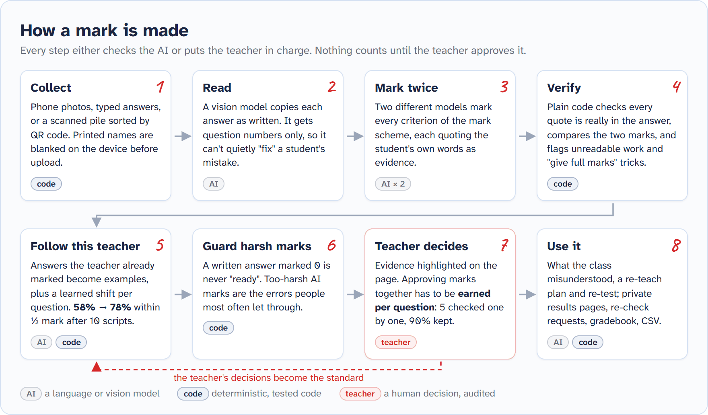</p>

## Earned trust

Nothing counts until a teacher approves it. On top of that, GradeLens has to earn every shortcut.

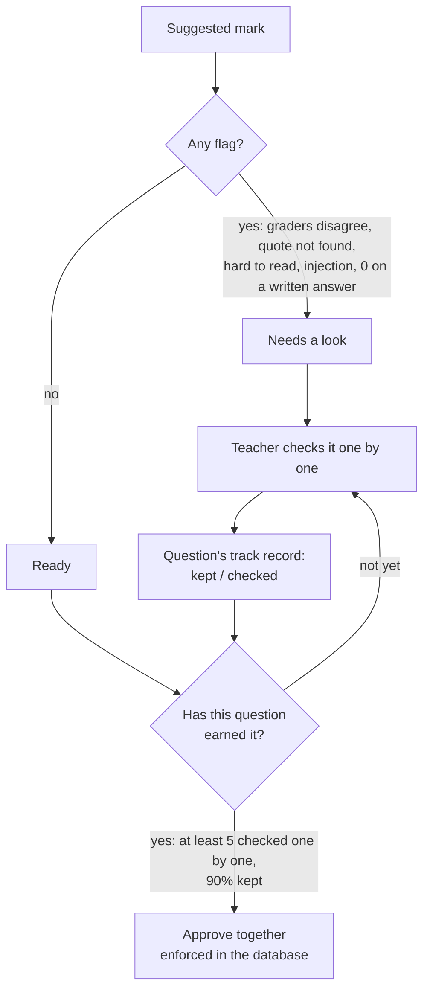

These screens come from replaying the dataset teacher's **real marks** as review decisions on 8 scripts:

<table>
<tr>
<td width="33%" valign="top">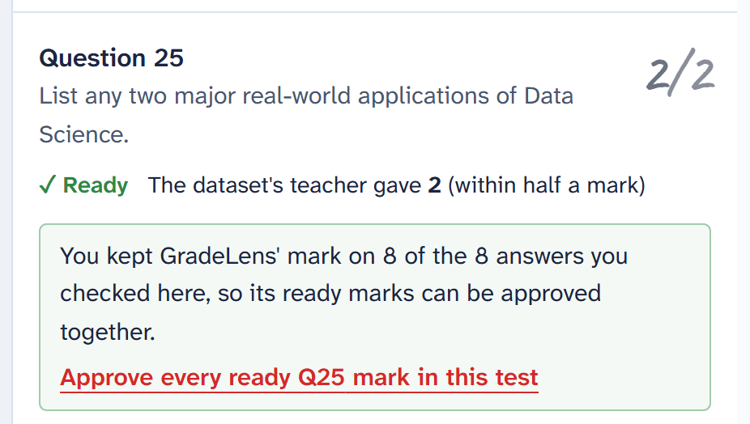<br/><b>Earned.</b> The teacher kept its mark on 8 of 8 answers, so the rest can be approved together.</td>
<td width="33%" valign="top">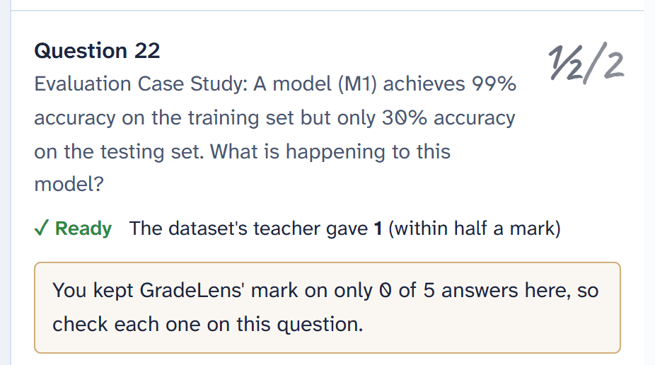<br/><b>Not earned.</b> 0 of 5 kept, so every answer on this question stays with the teacher.</td>
<td width="33%" valign="top">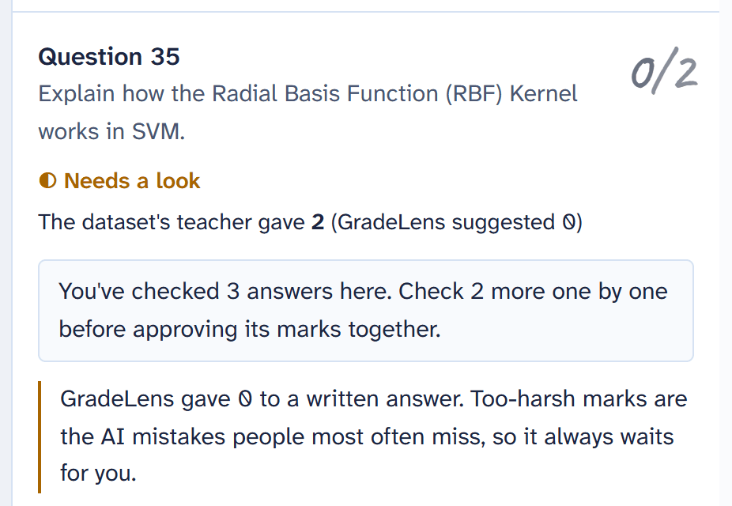<br/><b>Harsh mark stopped.</b> GradeLens gave 0; the real teacher gave 2. It could not pass unseen.</td>
</tr>
</table>

Each test also reports how closely GradeLens follows that teacher, from their own decisions:

<p align="center">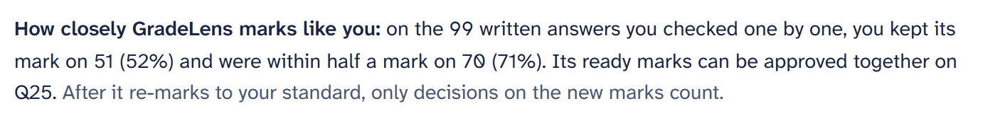</p>

The rule is enforced in Postgres (`question_track` and `bulk_approve`, migrations [`0010`](supabase/migrations/0010_earned_trust.sql) and [`0011`](supabase/migrations/0011_learned_suggestions.sql)), not only in the interface. After the teacher re-marks the class to their standard, only decisions on the new suggestions count.

## Measured results

GradeLens was evaluated on **real handwritten university exams** with each answer's mark from the real teacher ([Mendeley dataset](https://doi.org/10.17632/sf3kvjwknt.1), CC BY 4.0). Five students acted as the scripts a teacher reviews first. The other **20 students (225 short answers)** were held out: none of their marks were used as examples or to learn adjustments.

| Short answers, 2 marks each | Mark scheme only | + teacher's examples | + learned shifts | **Both (GradeLens)** |
|---|---:|---:|---:|---:|
| Within ½ mark of the teacher | 58.2% | 61.3% | 75.6% | **74.7%** |
| Exactly the teacher's mark | 45.3% | 46.7% | 44.9% | **51.1%** |
| Mean absolute error (marks) | 0.580 | 0.533 | 0.438 | **0.404** |
| Bias (negative = stricter than the teacher) | −0.518 | −0.418 | −0.224 | **−0.147** |
| Quadratic weighted kappa | 0.508 | 0.552 | 0.627 | **0.648** |

- **95% interval** for the 74.7%: 69% to 80%.
- **Multiple choice:** 391 of 400 handwritten letters read correctly (97.8%), then marked by plain code.

**It gets closer as the teacher marks.** Each student is predicted only from *other* students' teacher marks:

| Scripts the teacher has marked | 0 | 3 | 5 | 7 | 10 |
|---|---:|---:|---:|---:|---:|
| Within ½ mark of the teacher | 58% | 65% | 74% | 77% | 78% |

**The safety rules, tested on students they had never seen.** The harsh-mark guard and earned approval were designed after looking at 11 students, then frozen. The remaining **9 students (87 answers)** were marked afterwards:

| Unseen students only | Result |
|---|---|
| Within ½ mark of the teacher | 79.3% (kappa 0.66) |
| Big differences flagged for the teacher | 8 of 18 (2 of 18 without the guard) |
| Too-harsh marks flagged | 8 of 12 (2 of 12 without the guard) |
| Old "approve every ready mark" button | 77 of 87 approved unseen, 16 more than ½ mark off |
| Earned approval | 3 approved unseen, 1 more than ½ mark off |

Across all 20 students, the old button would have approved 198 of 225 answers unseen (49 off by more than half a mark); earned approval approved 11 (1 off).

> [!IMPORTANT]
> **GradeLens is a co-pilot, not an examiner.** Trained human markers reach a kappa of about 0.89 on short answers ([Shermis, 2024](https://arxiv.org/abs/2408.09540)), and 0.70 is a common minimum for automated scoring used alone (Williamson, Xi & Breyer, 2012). GradeLens' 0.65 is below both, which is why every mark waits for a teacher.

<details>
<summary><b>See how the app publishes this</b></summary>
<br/>
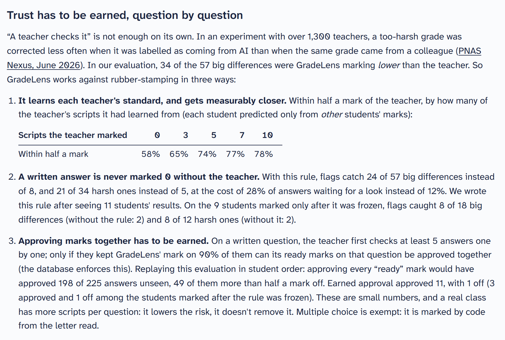
</details>

## Product tour

### Try it on real scripts, with no account

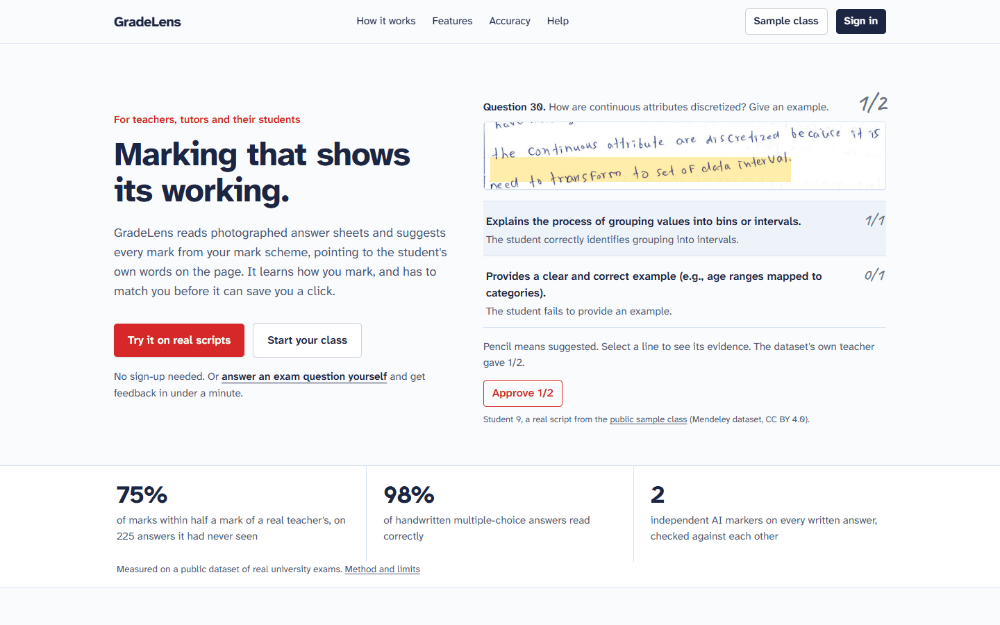

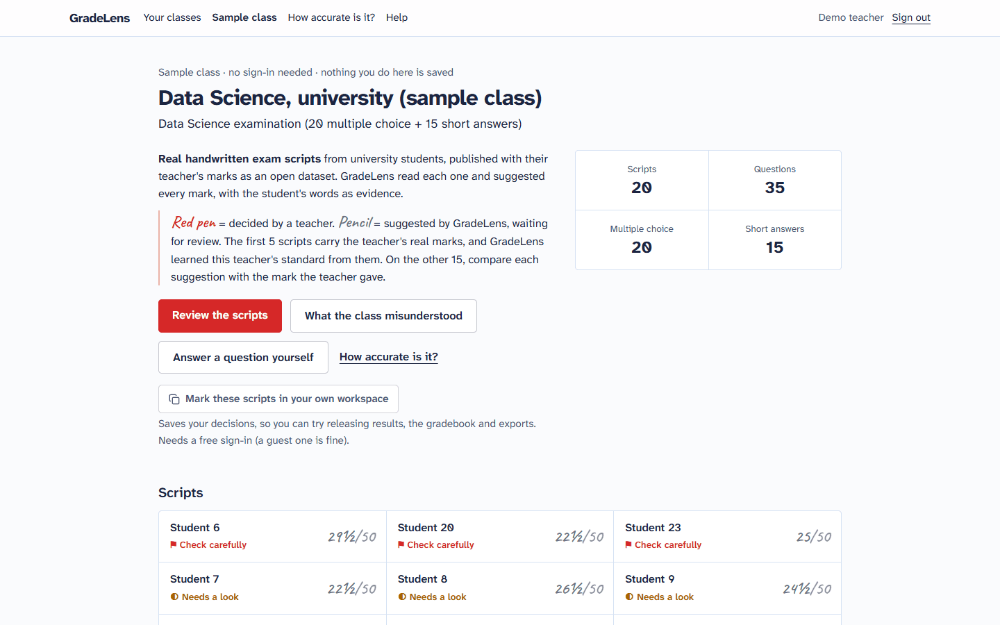

### From paper to marks

<table>
<tr>
<td width="50%" valign="top">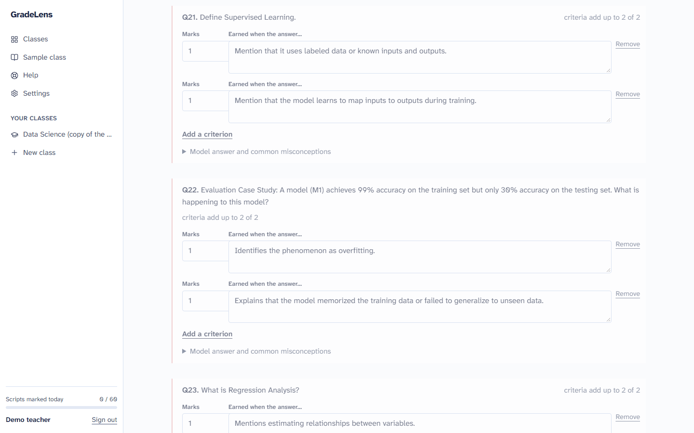<br/><b>Mark scheme.</b> Paste the paper and key; GradeLens drafts criteria, code checks that they add up, and the teacher approves them.</td>
<td width="50%" valign="top">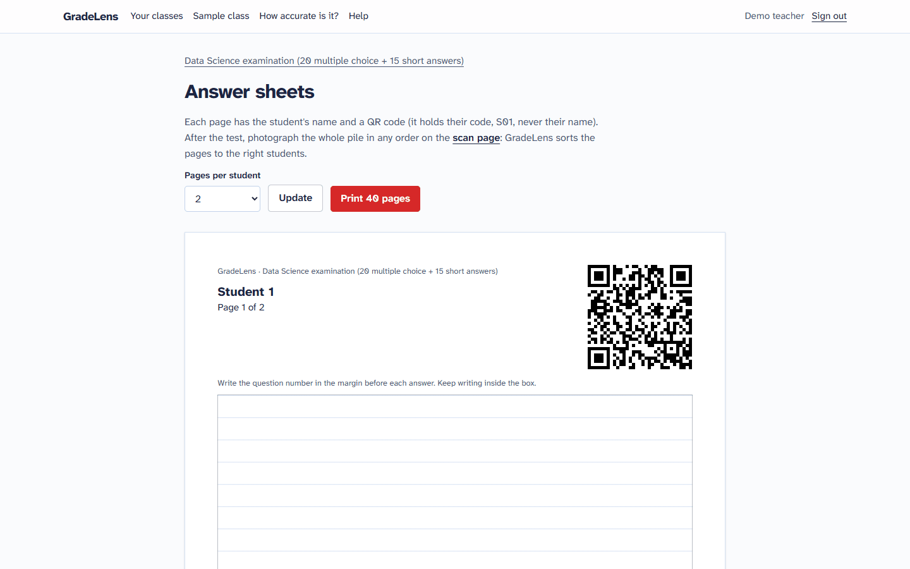<br/><b>QR answer sheets.</b> Personalised sheets carry a code, never a name, in the QR.</td>
</tr>
<tr>
<td valign="top">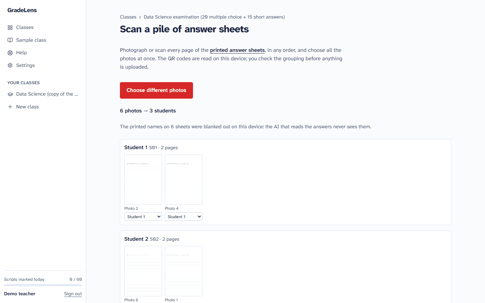<br/><b>Scan a pile, in any order.</b> Pages are sorted by QR on the device, and printed names are blanked before upload.</td>
<td valign="top">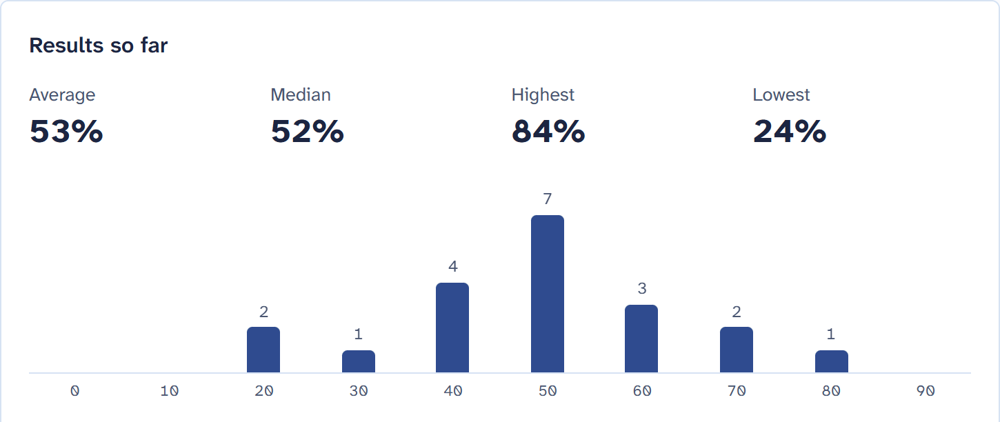<br/><b>Class results.</b> Score statistics and distribution as soon as scripts are marked.</td>
</tr>
</table>

### After marking

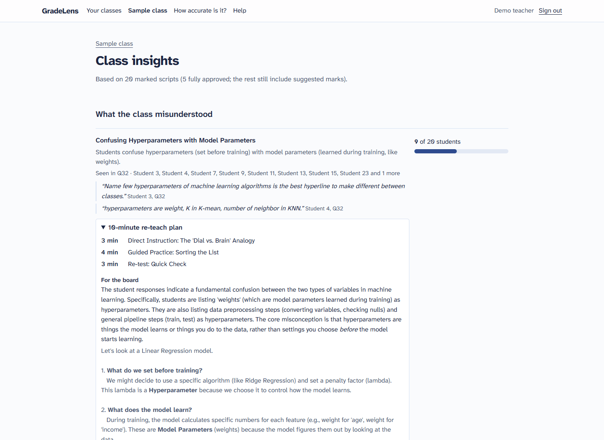

<sub>What the class misunderstood, with students' own words and a 10-minute re-teach plan. A worksheet and re-test follow, and learning gain is measured once the re-test is marked.</sub>

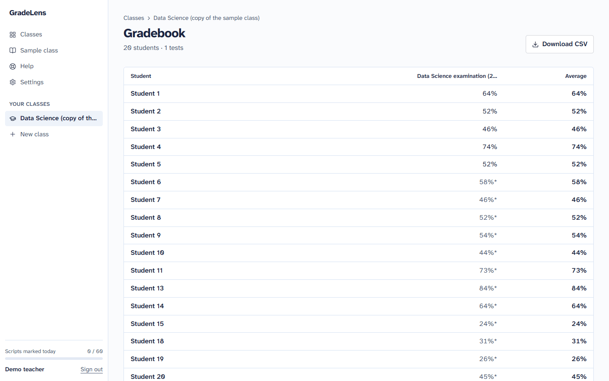

### On a phone

<table>
<tr>
<td width="25%" valign="top">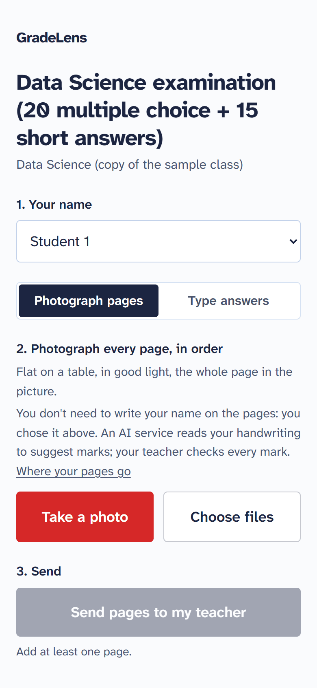<br/><b>Hand in</b><br/>Photo or typed, no account.</td>
<td width="25%" valign="top">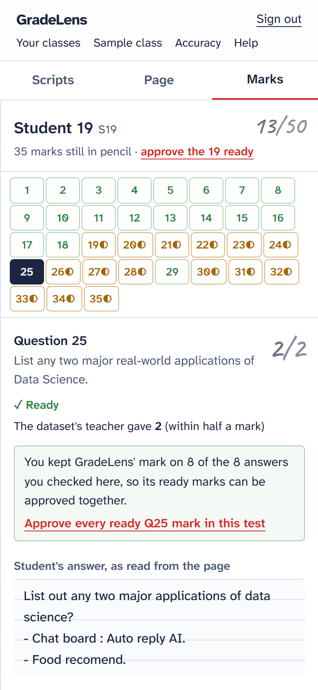<br/><b>Review</b><br/>The full marking sheet.</td>
<td width="25%" valign="top">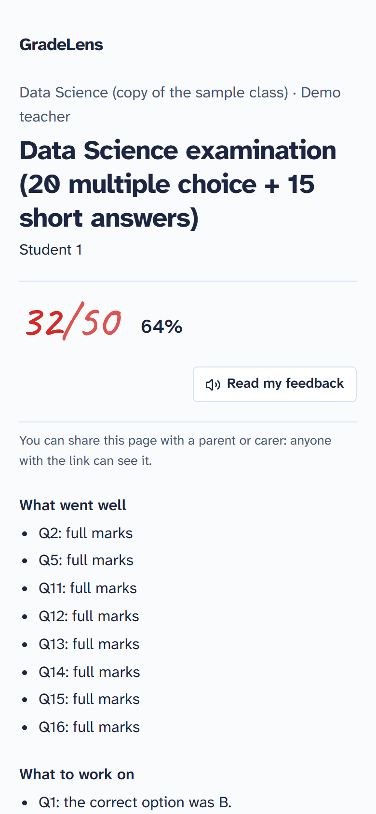<br/><b>Results</b><br/>Private link, read aloud, re-check requests.</td>
<td width="25%" valign="top">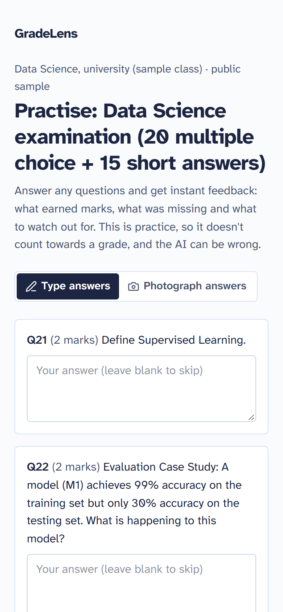<br/><b>Practice</b><br/>Instant feedback that never counts as a grade.</td>
</tr>
</table>

<details>
<summary><b>Full feature list</b></summary>

**For teachers**
- Mark-scheme builder from a pasted paper and key, with a question-paper check
- Student upload link and QR code, printed QR answer sheets, bulk scan in any order
- Review queue ordered by risk, evidence highlighting, keyboard marking (`A`, `0`–`9`, `H`, `J`/`K`, `N`/`P`)
- Anonymous marking, a comment bank of earlier notes, "Re-mark the rest" to the teacher's standard
- Measured marking time and agreement with GradeLens
- Misconception map, re-teach plan, worksheet, re-test and learning gain
- Item analysis (facility and discrimination), letter grades, gradebook, CSV exports

**For students and parents**
- Hand in by photo or typed answers, with no account
- Private results page with feedback that can be read aloud, shareable with a parent or carer
- Re-check requests on a single question, answered by the teacher
- Practice links with instant feedback

**For anyone evaluating it**
- A public sample class of real scripts, with no sign-in and no AI calls
- One click copies it into a guest workspace, so review, release, gradebook and exports work for real

</details>

## Architecture

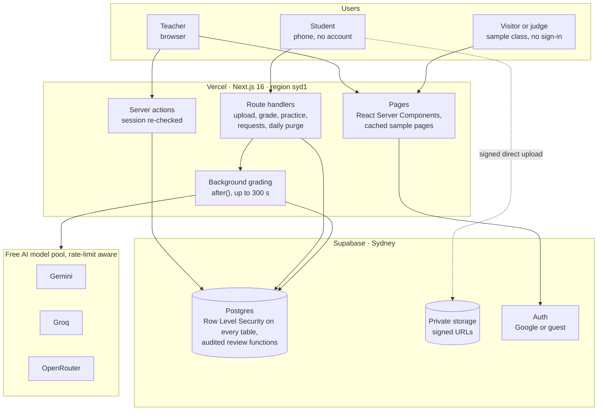

### Where AI is used, and where it deliberately isn't

| Step | Done by | Why |
|---|---|---|
| Reading handwriting | Vision model, given question numbers only | It can't quietly correct a student's mistake to match the question |
| Marking each criterion | Two different models, independently | A second opinion, with an evidence quote for every point |
| Checking quotes, comparing marks, spotting injection | **Plain code** ([`verifier.ts`](src/lib/grading/verifier.ts)) | A model should not be trusted to audit itself |
| Multiple-choice marks | **Plain code** | Deterministic once the letter is read |
| Learned per-question shift | **Plain code** ([`calibration.ts`](src/lib/grading/calibration.ts)) | Small, shrunk for few decisions, and shown on every adjusted mark |
| Earned approval, harsh-mark guard | **Plain code and SQL** ([`trust.ts`](src/lib/trust.ts)) | Safety rules shouldn't depend on a model's mood |
| Grouping misconceptions, re-teach plans | Model proposes, code rebuilds group membership | Useful language, verifiable membership |

**Stack:** Next.js 16 (App Router, Cache Components), React 19, TypeScript, Tailwind 4, Vercel AI SDK 7, Supabase (Postgres, Auth, Storage), Vercel. Models run on free tiers through a pool with per-call deadlines and rate-limit-aware fallback ([`pool.ts`](src/lib/ai/pool.ts)). The evaluation used Gemini Flash-family models and Qwen on Groq.

## Responsible AI and privacy

| Risk | What GradeLens does |
|---|---|
| Rubber-stamping AI marks | Bulk approval must be earned per question; written zeros always wait for the teacher |
| Invented evidence | Every point awarded on a written answer needs a quote that code finds in the answer; otherwise the mark is high risk |
| Students manipulating the marker | Instructions aimed at the grader are flagged, and the answer is marked on content only |
| Bias from knowing the student | Graders never receive names; teachers can hide names while marking |
| Student data on free AI tiers | Names stay out of AI calls, printed names are blanked **on the device**, and the policy is disclosed in the app |
| Unaccountable changes | Marks change only through audited database functions; teachers can't edit or delete the log |
| Students with no say | Results stay hidden until released, and students can request a re-check |
| Overclaiming | Accuracy, method and limits are published in the app, including where the rules fall short |

## Security

- **Row Level Security on every table.** Teachers see only their own classes; the sample class is public and read-only.
- **Server-only secrets and tokens.** Upload and practice tokens are hidden from the public API by column grants.
- **Uploads** use unguessable per-test tokens, signed URLs, path validation and daily limits.
- **Free-quota protection:** daily caps per guest (12 scripts), per teacher (60) and overall (150).
- **Headers and exports:** no framing, nosniff, HSTS, no-store on token pages, and CSV formula-injection protection.
- **Data retention:** guest workspaces are deleted after 7 days; teachers can delete a class or their account at any time.

## Testing

| Command | What it covers | Result |
|---|---|---|
| `npm test` | Verifier, marking, calibration, earned trust, evidence placement, QR sorting, item analysis | 69 tests |
| `npm run db:rls-check` | Isolation, hidden tokens, audit integrity and earned approval, against a real database | 41 checks |
| `node scripts/e2e-offline.mjs <dir>` | Teacher and student flows in a real browser, with no AI calls | 25 checks |
| `node scripts/check-public.mjs` | Every public page on desktop and phone | 14 checks |
| `npm run eval -- -t grade` | The real-data evaluation (cached by content hash, resumable) | [Results](#measured-results) |

Type checks, lint and unit tests run on every push through [GitHub Actions](.github/workflows/ci.yml).

## Getting started

**You need:** Node.js 22, a free [Supabase](https://supabase.com) project, and at least one free key from [Google AI Studio](https://aistudio.google.com), [Groq](https://console.groq.com) or [OpenRouter](https://openrouter.ai).

```bash
git clone https://github.com/roybishal362/GradeLens.git
cd GradeLens
npm install
cp .env.example .env.local   # then fill in the values below
npm run db:migrate           # applies supabase/migrations
npm run dev                  # http://localhost:3000
```

| Variable | Purpose |
|---|---|
| `NEXT_PUBLIC_SUPABASE_URL` | Your Supabase project URL |
| `NEXT_PUBLIC_SUPABASE_PUBLISHABLE_KEY` | Supabase publishable key |
| `SUPABASE_SECRET_KEY` | Supabase secret key (server only) |
| `DATABASE_URL` | Transaction pooler URL, used by the migration and security-check scripts |
| `GEMINI_API_KEYS`, `GROQ_API_KEYS`, `OPENROUTER_API_KEYS` | Comma-separated free-tier keys |
| `CRON_SECRET` | Any long random string, sent by Vercel Cron to `/api/cron/purge` |
| `NEXT_PUBLIC_SITE_URL` | Optional public address |

In Supabase, enable **anonymous sign-ins** for guest access and, optionally, the **Google** provider.

<details>
<summary><b>Reproduce the evaluation and the sample class</b></summary>

Download the [dataset](https://doi.org/10.17632/sf3kvjwknt.1) into `../datasets/mendeley-sf3kvjwknt/` (expected layout: [`mendeley-data.ts`](src/eval/mendeley-data.ts)), then:

```bash
# marks 20 held-out students; the last 9 are reported separately as the clean test
EVAL_CALIBRATE=1-5 EVAL_STUDENTS=6-25 EVAL_CLEAN_STUDENTS=12,16-20,22,24,25 npm run eval -- -t grade

# builds the public sample class from those cached results
SEED_CALIBRATE=1-5 SEED_STUDENTS=6-25 npm run eval -- -t seed

# recaptures every image in this README from a production build
npx next build && npx next start -p 3001
APP_URL=http://localhost:3001 node scripts/readme-shots.mjs docs/images
```

Free models change over time, so a fresh run can differ from the published numbers.
</details>

## Project structure

```text
src/
├─ app/                 Pages and API routes
│  ├─ app/              Teacher workspace: classes, tests, review, insights, gradebook
│  ├─ sample/           Public sample class
│  ├─ transparency/     Published accuracy, method, limits and privacy
│  ├─ u/  r/  p/        Student upload, results and practice (private links)
│  └─ api/              Upload, grading, practice, requests, daily purge
├─ components/          Review workspace, insights, shell, marks
├─ lib/
│  ├─ grading/          Prompts, pipeline, verifier, calibration, evidence, mark schemes
│  ├─ ai/               Free-model pool with deadlines and fallback
│  ├─ insights/         Item analysis, misconceptions, re-teach
│  ├─ jobs/             Background grading job
│  ├─ db/               Data loaders
│  └─ trust.ts          Earned-approval rule
├─ eval/                Real-data evaluation and sample-class seeding
└─ data/                Published evaluation summary
supabase/migrations/    Schema, RLS policies and audited review functions
scripts/                Security, browser and page checks, README screenshots
```

## Limitations

- **One teacher, one subject, one exam:** university Data Science in English, with 2-mark short answers. Other subjects, ages, languages and longer answers are untested here.
- **Below human agreement.** Kappa 0.65 against about 0.89 for trained markers. It must not mark without a teacher.
- **Flags still miss big differences:** 33 of 57 across all held-out students. Most are judgement calls where both AI markers agreed with each other but not with the teacher.
- **Earned approval lowers risk but doesn't remove it:** 1 of the 11 marks it approved unseen was more than half a mark off.
- **Small samples:** the unseen-student test has 87 answers, and the learning curve is a simulation from one teacher's marks.
- **No classroom trial yet.** Time savings have not been measured with real teachers; the figures in [The problem](#the-problem) come from published studies.
- **Free AI tiers** can be rate-limited, and their terms may allow providers to use submitted content. A school should use paid keys, which work without code changes.
- **Diagrams and long multi-step maths** were tried only on a handful of practice pages.

## Data and credits

The sample class and evaluation use: Dinesh K P, *A Dataset of Digitized Student Examination Papers, Answer Keys, and Manual Evaluations for Automated Grading Research*, Mendeley Data, V1, [doi:10.17632/sf3kvjwknt.1](https://doi.org/10.17632/sf3kvjwknt.1), licensed [CC BY 4.0](https://creativecommons.org/licenses/by/4.0/). Students are identified only by number.

Built by **Bishal Roy** for [SLAY HACKS 2026](https://slayy-hacks.devpost.com/).

**Licence:** no open-source licence has been chosen yet, so the code is shared for review and all rights are reserved. The dataset images remain under CC BY 4.0.
