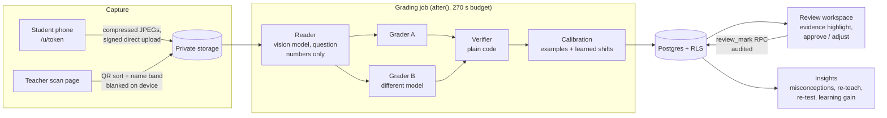

# GradeLens

**An AI grading co-pilot for handwritten answers. You approve. You don't grade.**

GradeLens reads photographed answer sheets, suggests every mark from the teacher's mark scheme, and shows the exact
handwriting behind each one. Nothing counts until the teacher approves it. Then it shows what the class misunderstood,
plans a 10-minute re-teach with a worksheet and a short re-test, and measures who improved.

- **Evidence first.** Every suggested mark quotes the student's own words, highlighted on their page. Plain code checks
  that each quote really is in the answer.
- **Two independent graders.** Two different AI models mark every answer. Disagreements, unclear handwriting and
  instructions aimed at the grader wait for the teacher.
- **It learns how you mark.** The teacher's first decisions become examples for the graders and a per-question shift,
  measured on held-out real scripts (see [Accuracy](#accuracy)).
- **Pencil and red pen.** AI suggestions are drawn in pencil; a teacher's approval turns them into red pen. Every decision
  is in an audit log that can't be bypassed.

## Accuracy

Measured against a real teacher's item-level marks on real handwritten university exams (Mendeley dataset, CC BY 4.0):
GradeLens marked the first students, the teacher's real marks for them became the examples and learned shifts, and the
other students were the test. The results, the human baseline (trained markers average a quadratic weighted kappa of .89
on short answers) and the limits are on the **/transparency** page, generated from `src/data/eval-summary.json`, which
`npm run eval` writes. GradeLens is a co-pilot: its agreement with the teacher is below what trained humans reach, which
is why every mark waits for approval.

## How it works



1. **Mark scheme.** The teacher pastes the question paper and key. An agent splits it into questions and drafts criteria
   (marks per criterion must add up, checked by code). Multiple choice is marked by code, not a model. An optional
   "check the paper" agent reports the thinking each question asks for and ambiguous wording before the test is given.
2. **Collect.** Students open the upload link (QR on the board), pick their name and photograph their pages. Or the teacher
   prints personalised QR answer sheets and photographs the whole pile: pages are sorted to students by QR, and the
   printed name band is blanked out on the device before upload.
3. **Read.** One vision call per script transcribes every answer as written. The reader gets question numbers and types
   only, never the questions, so it copies students' mistakes instead of silently correcting them. Crossed-out work is
   ignored and answers follow the student's own labels. Each line gets a bounding box on the page.
4. **Grade and verify.** Two different free models grade each criterion with an evidence quote. The verifier (code)
   rejects invented quotes, compares the two marks, routes low reading confidence and injection attempts to the teacher,
   and removes structure marks from diagrams that weren't drawn. The suggestion is the two graders' average, then the
   question's learned shift (always shown on the mark).
5. **Review.** Queue by risk, the student's page with the evidence highlighted, keyboard marking (A, 0-9, H, J/K, N/P),
   bulk approval of ready marks. Decisions go through `review_mark` / `bulk_approve` (security-definer functions that
   write the audit event and the mark in one transaction).
6. **Insights.** Item analysis (facility, discrimination), misconceptions grouped across the class (the AI proposes
   groups; membership is rebuilt by code), a re-teach plan + printable worksheet + re-test, and learning gain
   (Hake's normalised gain) once the re-test is marked. Student progress over time and a printable report.

## Stack

Next.js 16 (App Router, Cache Components, proxy.ts), React 19, Tailwind 4, AI SDK 7, Supabase (Postgres, Auth, Storage),
Vercel. **Free tiers only:** a model pool rotates Gemini, Groq and OpenRouter free models with rate-limit-aware backoff
(`src/lib/ai/pool.ts`).

## Security and privacy

- Row Level Security on every table; teachers see only their classes; the sample class is public and read-only.
  `npm run db:rls-check` runs 31 checks against the live database (isolation, hidden upload tokens, audit integrity,
  server-only functions).
- Server actions re-check the session and write through RLS; the server key is used only after an ownership check.
- Student uploads: unguessable per-test token (timing-safe check), signed upload URLs, path validation, per-device and
  per-test daily limits. Grading has per-account and global daily caps to protect the free quota.
- Security headers (Referrer-Policy for token URLs, no framing, nosniff, HSTS); upload pages are noindex and no-store.
- Free AI tiers may use submitted content (Google's unpaid Gemini terms), so names never go to the graders, QR sheets
  carry codes only, printed names are blanked on the device, and the policy is disclosed. Paid keys work unchanged.
- Guest workspaces are deleted after 7 days (Vercel Cron → `/api/cron/purge`); teachers can delete a class with all files.

## Run it locally

```bash
npm install
cp .env.example .env.local   # then fill in the values (see below)
npm run db:migrate           # applies supabase/migrations
npm run dev
```

`.env.local` needs: `NEXT_PUBLIC_SUPABASE_URL`, `NEXT_PUBLIC_SUPABASE_PUBLISHABLE_KEY`, `SUPABASE_SECRET_KEY`,
`DATABASE_URL` (Transaction pooler), `GEMINI_API_KEYS`, `GROQ_API_KEYS`, `OPENROUTER_API_KEYS` (comma-separated lists),
`CRON_SECRET`.

## Tests

| Command | What it checks |
|---|---|
| `npm test` | unit tests: verifier, MCQ marking, calibration, evidence placement, QR sorting, item analysis, learning gain |
| `npm run db:rls-check` | row level security and audit integrity against the real database |
| `node scripts/e2e-offline.mjs` | every teacher screen in a real browser, no AI calls |
| `node scripts/e2e.mjs` | the whole flow with real AI: paper → mark scheme → phone upload → grading → review |
| `node scripts/check-public.mjs` | every public page on desktop and phone |
| `npm run eval -- -t grade` | the real-data evaluation (cached by content hash, resumable) |

## Data

The sample class and the evaluation use: Dinesh K P, "A Dataset of Digitized Student Examination Papers, Answer Keys, and
Manual Evaluations for Automated Grading Research", Mendeley Data, V1, doi:10.17632/sf3kvjwknt.1, CC BY 4.0. Students
are identified only by number.
